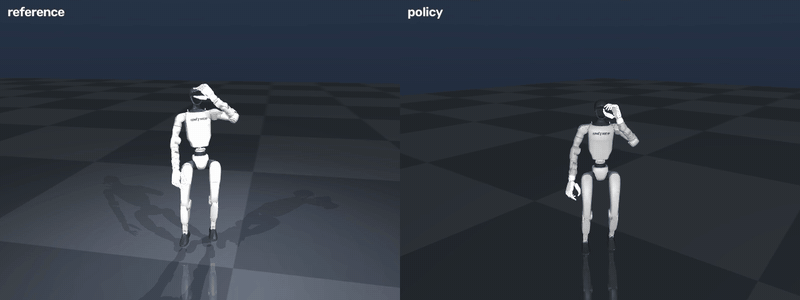
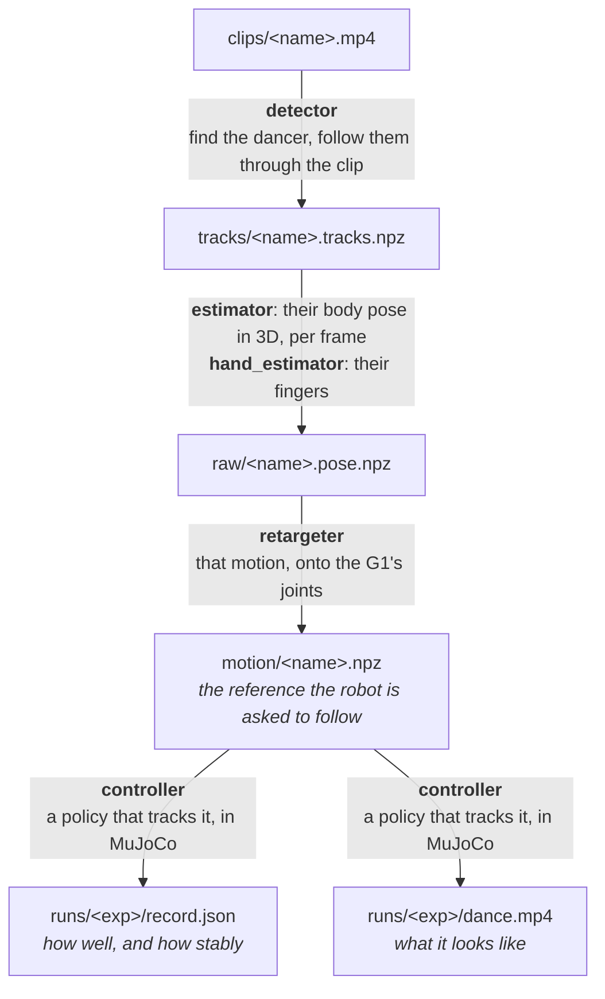

# g1-dance

Make a Unitree G1 dance from a video, in simulation, with no training.

Give it a clip of someone dancing. It finds the dancer, lifts their motion into
3D, retargets it onto a G1 with Inspire hands, and has a downloaded general
tracking policy perform it under physics in MuJoCo. Every stage is a module you
can swap from a config file. Simulation only; nothing here touches hardware.



## How it works



Each of the five stages is a registry of interchangeable modules, chosen by
name. Every stage reads and writes a file, so any stage can be rerun or
inspected on its own, and a run only recomputes what changed.

## Install

```bash
uv venv -p 3.12 .venv
uv pip install -e ".[dev]"
python tools/build_model.py        # assemble the G1 + Inspire hand MuJoCo model
g1dance components                 # what is installed at each stage
```

That is enough for the fast path (`pipelines/zeroshot.yaml`). The MediaPipe
models and the Humanoid-GPT tracker download themselves on first use into
`~/.cache/g1dance/models`.

The best path (`pipelines/gvhmr.yaml`) needs three more things, none of which is
fetched automatically:

1. **The SMPL-X body model.** Register at <https://smpl-x.is.tue.mpg.de>,
   download `models_smplx_v1_1.zip`, and put `SMPLX_NEUTRAL.npz` in
   `assets/smplx/`. It is non-commercial; see [Licensing](#licensing).
   Then `uv pip install -e ".[bodymodel,fingers]"`.
2. **GMR**, the retargeter: `uv pip install -e ".[gmr]"`.
3. **GVHMR**, the estimator: clone <https://github.com/zju3dv/GVHMR> to
   `third_party/GVHMR`, install its requirements, and put its `gvhmr`, `hmr2`
   and `vitpose` checkpoints under `third_party/GVHMR/inputs/checkpoints/`
   (mirrored at <https://huggingface.co/camenduru/GVHMR>). On macOS arm64,
   `pytorch3d` does not build; see the note at the top of
   `src/g1dance/motion/frontends/gvhmr_fe.py` for the workaround.

If something is missing, the stage that needs it stops with a message saying
what to install and where.

## Quick start

```bash
g1dance run    clips/dance.mp4 --name dance --exp v1 --spec pipelines/gvhmr.yaml
g1dance render --name dance --exp v1 --full
```

`run` goes from the clip to `runs/v1/record.json` and prints a summary. `render`
plays the whole clip through as one episode and writes `runs/v1/dance_full.mp4`.
To get a clip from a URL first: `g1dance ingest <url> --name dance --start 18
--end 30`.

## Selecting modules

A spec is a YAML file naming one module per stage:

```yaml
# pipelines/gvhmr.yaml
detector:   mediapipe
estimator:  gvhmr
retargeter: gmr
controller: humanoid_gpt
env_config: configs/upper_body.yaml
```

A stage left out takes its default (`hand_estimator` here is `mediapipe`). Any
stage can also be overridden from the command line, without editing a file:

```bash
g1dance run clips/dance.mp4 --name dance --exp ol --spec pipelines/gvhmr.yaml \
    --controller open_loop
```

### The modules

| stage | module | what it does |
| --- | --- | --- |
| detector | `mediapipe` | multi-person pose, picks and follows one dancer |
| estimator | `gvhmr` | world-grounded SMPL-X; the only root that travels |
| | `smplest_x` | per-frame whole-body SMPL-X from the crop |
| | `mediapipe` | 33 body landmarks on the crop; fast, no body model |
| | `smpl` | reads SMPL/SMPL-X parameters from a file (AMASS) instead of a video |
| hand_estimator | `mediapipe` | 21 landmarks per hand, cropped at the wrist |
| | `none` | fingers hold a neutral pose |
| retargeter | `gmr` | General Motion Retargeting; needs SMPL-X parameters |
| | `builtin` | this repo's per-bone scaled IK; works from landmarks |
| controller | `humanoid_gpt` | Humanoid-GPT, a zero-shot general tracker (ONNX) |
| | `humanoid_gpt_216`, `humanoid_gpt_trans` | its other released checkpoints |
| | `open_loop` | PD straight to the reference: the lower bound |
| | `zero_action` | hold the standing pose, ignore the reference |

`g1dance components` prints the same list from the installed code.

Not every combination works, and `run` refuses an impossible one before
anything runs: `gmr` needs an estimator that produces SMPL-X parameters
(`gvhmr`, `smplest_x`, `smpl`), and the `mediapipe` hand estimator needs one
that produces pixel landmarks (`gvhmr`, `mediapipe`).

### Module options

A stage given as a mapping passes options to its module:

```yaml
retargeter: {name: gmr, max_root_yaw_rate: 60.0}   # deg/s cap on turning
controller: {name: humanoid_gpt, anchor: true}     # see below
```

`anchor` (on by default) rotates the reference so its first frame faces the
way the robot does. Without it, a robot that cannot turn far would spend the
whole clip facing the wrong way.

### Two environment modes

`env_config` picks what the robot is asked to track.

| config | tracks | the robot |
| --- | --- | --- |
| `configs/upper_body.yaml` | waist and arms (17 DoF) | stands and balances on its own; arms and torso dance |
| `configs/whole_body.yaml` | all 29 DoF and the root | steps and travels with the dancer |

Use `upper_body`. With this tracker, `whole_body` measured worse: on kirari,
end to end 0.65 against 0.79, and about half the episodes fell.

### Caching

Each stage's output is keyed on the spec up to that stage, the configs it reads
and the source code it runs. Change the controller and the next `run` reuses
the reference and takes seconds; fix a bug in a retargeter and only the
retarget stage and what follows it rerun. Code under `third_party/` is not
part of the key, so after changing it pass `--force`.

## Reading the results

`run` writes a record and prints it as a table:

```
  stage                        corr     sd
  ---------------------------------------
  source -> reference         0.920  0.000
  reference -> policy         0.770  0.039
  end to end                  0.731  0.056

  stability            surv@5s   dof_err  link_err    slip
  -------------------------------------------------------
  nominal                1.000     0.129     0.093   0.187
  randomised             1.000     0.130     0.094   0.196
  reference                  -     0.000     0.000   0.000
  open_loop              0.000     0.120     0.159   0.103
```

That is for the dance demo gif values.

- **Similarity** is the correlation of wrist and elbow trajectories, in the
  body frame, between the video and the reference, the reference and the robot,
  and the video and the robot end to end. 1.0 is a perfect copy.
- **Stability** is the fraction of episodes still upright after 5 s, and the
  tracking errors. `randomised` repeats it with friction, mass and pushes
  varied. `open_loop` is the same reference with no tracker, for scale.
- Every figure is a mean over 12 seeds, each starting at a random frame.

`g1dance compare runs/a runs/b` prints records side by side. It deliberately
picks no winner: the row above shows why, since open loop has the lower joint
error and falls over immediately.

`g1dance render --name <name> --exp <exp>` lays out four panels: the source, the
source with the 2D pose the reference was estimated from, the reference, and
the robot. It reads the clip, config and controller from the run's record, and
reports whether the robot fell or the clip ran out. `--full` plays the whole
clip from the first frame; without it, one 10 s evaluation episode is shown.

## Limits

- **Arms and torso only.** In `upper_body` the robot does not step, travel, or
  turn more than about 30 degrees. A dance led by the legs, with lunges or
  jumps, comes through as an upright robot with the right arms.
- **Whole body is worse, for now.** Following GVHMR's travelling root lowered
  both fidelity and survival with this tracker.
- **Monocular video.** Fast spins, jumps, floor work, feet out of frame, camera
  cuts and loose clothing all degrade the pose before anything else runs.
- **Time.** GVHMR takes about 0.6 s a frame on CPU: four minutes for 12 s of
  video.

## Licensing

The code in this repository is MIT licensed; see [LICENSE](LICENSE). That
covers this project's own code only. The models, assets and repositories below
keep their own terms.

The **SMPL-X body model is non-commercial and registration gated.** It is not
shipped, downloaded automatically or committed. Everything built on it, which is
the `gvhmr`, `smplest_x` and `smpl` estimators and the `gmr` retargeter,
inherits its terms. `pipelines/zeroshot.yaml` does not use it.

The G1 description is from `unitreerobotics/unitree_ros`, with Inspire hands
retargeted by `dexsuite/dex-retargeting` on `dexsuite/dex-urdf` assets. The
tracker is `GalaxyGeneralRobotics/Humanoid-GPT`, Apache-2.0 for both code and
checkpoints, which are downloaded and cached rather than committed.
